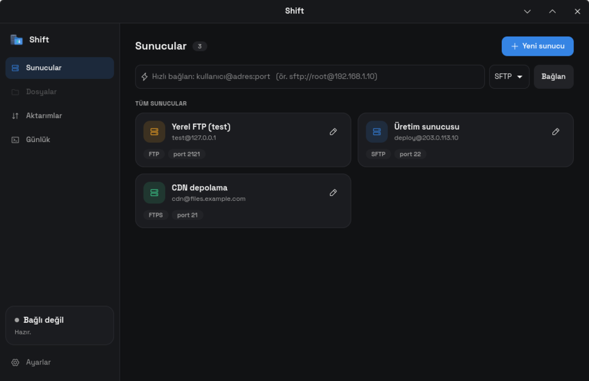
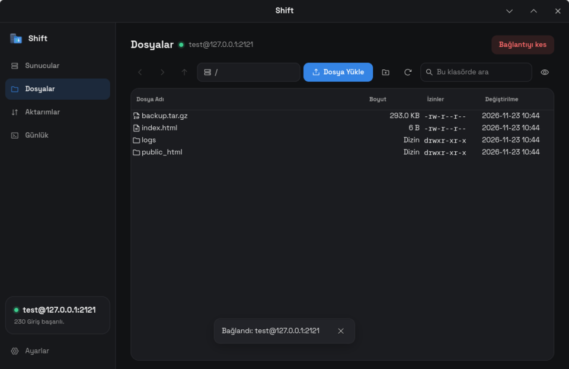
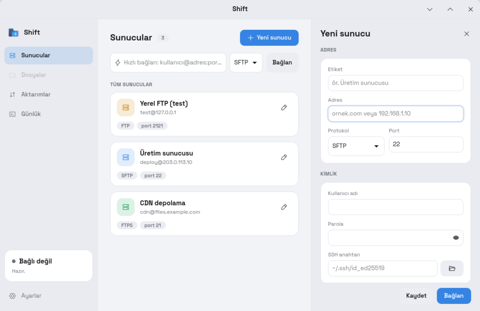

<p align="center">
  
</p>

<h1 align="center">Shift</h1>

<p align="center">
  FTP, FTPS ve SFTP için modern, hafif masaüstü dosya aktarım istemcisi.<br>
  Rust + GTK4 · GNOME, KDE Plasma, XFCE ve diğer Linux masaüstlerinde aynı görünüm.
</p>

<p align="center">
  
</p>

| Dosyalar | Sunucu düzenleme (açık tema) |
| --- | --- |
|  |  |

## Özellikler

- **Sunucular** — kayıtlı sunucular kart ızgarasında; karta tıklayınca bağlanır. Protokole göre renkli simge (SFTP mavi, FTP turuncu, FTPS yeşil).
- **Hızlı bağlantı** — üstteki çubuğa `sftp://root@192.168.1.10:22/var/www` gibi bir adres yazıp Enter. Protokol, kullanıcı, port ve başlangıç dizini adresten okunur; parola sorulur, istenirse sunucu kaydedilir.
- **Sunucu düzenleyici** — sağdan açılan panel: etiket, adres, protokol, port, kullanıcı, parola, SSH anahtarı ve "Gelişmiş" bölümünde dizin, aktarım ve ağ seçenekleri.
- **Dosyalar** — geri/ileri/üst dizin, yol çubuğu, arama, gizli dosyaları göster/gizle, dosya yükleme, yeni klasör, sağ tık menüsü (aç, indir, yeniden adlandır, sil, yenile).
- **Aktarımlar** — oturumdaki yükleme ve indirmeler; durum: *Sürüyor / Tamamlandı / Hata*.
- **Günlük** — sunucuyla konuşulan komut ve yanıtlar, saat damgalı; kopyala ve temizle.
- **Görünüm** — açık/koyu mod masaüstünü izler (Ayarlar → Görünüm ile sabitlenebilir), vurgu rengi masaüstünden gelir (GNOME 47+, KDE Plasma 6), yazı tipi sistemin yazı tipidir.
- **Masaüstüne uyum** — GNOME ailesinde başlık çubuğu uygulamanın içindedir; KDE, XFCE, MATE, Cinnamon gibi ortamlarda pencere başlığını ve düğmelerini masaüstü çizer (kendi düzeni ve temasıyla).

## Gereksinimler

| | Sürüm |
| --- | --- |
| Rust | güncel stable (1.98 ile derlendi) |
| GTK | 4.12+ (koyu modu masaüstünden otomatik izlemek için 4.20+ önerilir) |
| Derleme araçları | `pkg-config`, `glib-compile-resources` (glib2 geliştirme paketi), OpenSSL geliştirme paketi |

Fedora:

```bash
sudo dnf install rust cargo gtk4-devel openssl-devel pkgconf-pkg-config
```

Debian / Ubuntu (paket adları, denenmedi):

```bash
sudo apt install rustc cargo libgtk-4-dev libssl-dev pkg-config libglib2.0-dev-bin
```

Arch (denenmedi):

```bash
sudo pacman -S rust gtk4 openssl pkgconf
```

libadwaita **gerekmez**.

## Derleme ve çalıştırma

```bash
cargo build --release
./target/release/shift
```

## Kurulum (kullanıcı için)

```bash
cargo build --release
install -Dm755 target/release/shift ~/.local/bin/shift
for s in 16 24 32 48 64 128 256 512; do
  install -Dm644 "data/icons/hicolor/${s}x${s}/apps/com.ensignsoft.Shift.png" \
    "$HOME/.local/share/icons/hicolor/${s}x${s}/apps/com.ensignsoft.Shift.png"
done
install -Dm644 data/com.ensignsoft.Shift.desktop ~/.local/share/applications/com.ensignsoft.Shift.desktop
```

`~/.local/bin` PATH'te olmalıdır. Kaldırmak için aynı dosyaları silmek yeterli.

## Veriler

| Dosya | İçerik |
| --- | --- |
| `~/.config/shift/servers.json` | Kayıtlı sunucular (parolalar dahil, **düz metin**) |
| `~/.config/shift/appearance` | Görünüm seçimi: `system`, `light` veya `dark` |

İndirilen dosyalar `~/İndirilenler` (XDG Downloads) klasörüne kaydedilir.

## Proje yapısı

```
src/
  main.rs            pencere, kenar çubuğu, olay döngüsü, backend çağrıları
  engine.rs          FTP/FTPS (suppaftp) ve SFTP (ssh2) bağlantıları
  models.rs          ServerProfile, Protocol, FileItem
  server_store.rs    servers.json okuma/yazma
  ui/
    theme.rs         tasarım sistemi: açık/koyu palet, bileşen stilleri
    accent.rs        masaüstü vurgu rengi (XDG portal, GIO D-Bus)
    hosts.rs         Sunucular sayfası, hızlı bağlantı, düzenleme paneli
    explorer.rs      Dosyalar tablosu ve sağ tık menüsü
    transfers.rs     Aktarımlar sayfası
    log_page.rs      Günlük sayfası
    widgets.rs       ortak bileşenler (diyaloglar, bildirim, form)
    icons.rs         simge adları
data/
  logo/              ana logo (1568 px)
  icons/hicolor/     uygulama simgesi, 16–512 px
  icons/shift/       arayüz simgeleri (Phosphor)
  resources.gresource.xml
  com.ensignsoft.Shift.desktop
```

## Tasarım

Yerleşim Termius'tan esinlenir (kenar çubuğu, sunucu kartları, sağdan açılan düzenleyici). Renk paleti ve köşe yuvarlaklıkları quick-send'in `QsPalette`'inden, kart ve durum göstergeleri Kota'dan gelir. Tüm renkler `src/ui/theme.rs` içinde tek yerde tanımlıdır.

## Geliştirici araçları

Arayüzü masaüstü olmadan kontrol etmek için ortam değişkenleri:

| Değişken | Etki |
| --- | --- |
| `SHIFT_CSD=1` / `0` | Başlık çubuğunu uygulama mı, masaüstü mü çizsin (varsayılan: masaüstüne göre) |
| `SHIFT_SNAPSHOT=/yol.png` | Pencereyi (ve açık diyalogları) PNG olarak kaydedip çıkar |
| `SHIFT_SNAPSHOT_DELAY=ms` | Görüntü almadan önce bekleme (varsayılan 1500) |
| `SHIFT_ACTION=site-manager` | Açılışta bir eylem çalıştır (`site-manager`, `toggle-log`, `about`) |
| `SHIFT_AUTOCONNECT=0` | Açılışta N'inci kayıtlı sunucuya bağlan |
| `SHIFT_DUMP_TREE=1` | Bileşen ağacını boyutlarıyla stderr'e yaz |

Gerçek sunucu verilerine dokunmadan denemek için: `XDG_CONFIG_HOME=/tmp/shift-test ./target/release/shift`

Test: `cargo test parses_quick_connect_targets`

## Bilinen eksikler

- Sunucu düzenleyicinin "Gelişmiş" bölümündeki aktarım modu, hız sınırları, karakter kodlaması ve proxy seçenekleri henüz kaydedilmiyor ve bağlantıda kullanılmıyor.
- SSH anahtarı seçilebiliyor ama SFTP bağlantısı yalnızca parola ile yapılıyor.
- Yol çubuğundaki klasör adlarına tıklanamıyor.
- Parolalar `servers.json` içinde düz metin olarak saklanıyor (sistem anahtarlığı kullanılmıyor).
- Aktarımlar sırayla yapılıyor; ilerleme yüzdesi ve iptal yok.
- Arayüz yalnızca Türkçe.

## Lisans

Shift'in kendi lisansı henüz belirlenmedi.

Üçüncü parti: arayüz simgeleri [Phosphor Icons](https://phosphoricons.com) — MIT Lisansı, bkz. `data/icons/shift/LICENSE-phosphor`.
